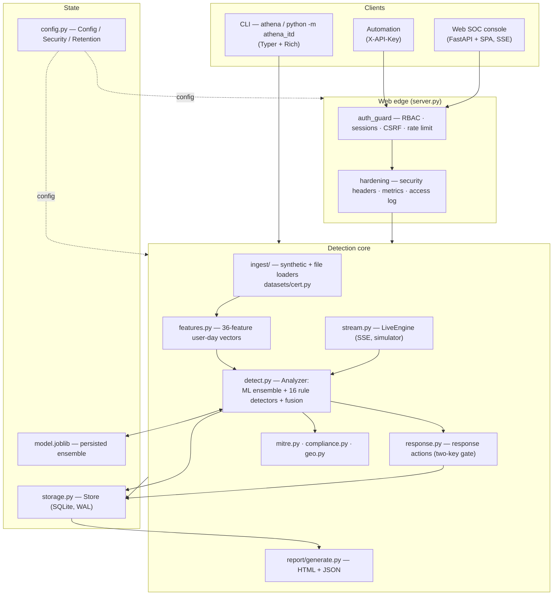

# Architecture

ATHENA ITD is a single Python package (`athena_itd`) that exposes the **same
detection core** through two front ends — a Typer/Rich **CLI** and a FastAPI
**web SOC console** — over one embedded **SQLite** datastore. There are no
external services to run; it scales from a laptop to a hardened server.

## Request/analysis flow

1. **Ingest** — events arrive from the synthetic generator, a file (`csv/json/jsonl/auth.log`),
   or the CMU CERT adapter, and are normalized into `Event` rows (`models.py`) in SQLite.
2. **Featurize** — `features.py` aggregates events into a 36-dimension per-user-per-day
   behavior vector (volume, off-hours, privilege, geo velocity, sequences, …).
3. **Score** — `detect.py` runs the ML ensemble (Isolation Forest + LOF + PCA
   reconstruction + Ledoit-Wolf Mahalanobis) **plus** 16 rule detectors, then fuses
   ML + rules + peer-group deviation + sequence rarity into one 0–100 risk score.
4. **Explain & enrich** — each `Alert` carries factor-by-factor evidence, σ-contributions,
   MITRE ATT&CK technique IDs (`mitre.py`) and compliance mappings (`compliance.py`).
5. **Respond** — `response.py` recommends/dispatches actions; real enforcement needs both
   `allow_enforced_response=true` and a per-call `force=true` (two-key gate). Simulated by default.
6. **Persist & surface** — alerts, cases, notes, feedback, responses and an append-only
   audit trail live in SQLite; the console and `report/generate.py` render them.

## Security & access (web edge)

Two ASGI middlewares wrap every request when `auth_enabled` is on:

- **`auth_guard`** — resolves the caller (session cookie → user, or `X-API-Key` → admin
  service principal), enforces **RBAC** (`viewer < analyst < admin`) per route, a **CSRF**
  double-submit check on cookie-authenticated mutations, and a per-caller **rate limit**.
- **`hardening`** — sets security headers (nosniff / DENY / no-referrer / Permissions-Policy,
  HSTS only over TLS), records Prometheus metrics, and emits an access log.

Sessions live in a `sessions` table (only a SHA-256 hash stored, TTL-bounded, revoked on
logout / password reset / role change / disable). Passwords use `scrypt`.

## Storage

Single SQLite database under `ATHENA_HOME` in **WAL** mode with a busy timeout, so the
web workers and CLI can read/write concurrently. The schema (events, alerts, responses,
cases, watchlist, notes, feedback, sessions, audit) is created idempotently on start.
The trained model is a separate `model.joblib` artifact. `athena backup` takes a
consistent online snapshot; `athena doctor` validates the whole deployment.

## Known boundaries (by design, documented honestly)

- **Storage:** SQLite is excellent to a point; high-volume / HA deployments want an
  external OLAP/OLTP store (Postgres/ClickHouse) — a `Store` reimplementation.
- **Live engine:** `stream.py` is a **simulator** for demos and load-testing the scoring
  path. Production needs real connectors (syslog/Kafka receiver, IdP/EDR/CASB pull).
- **Identity:** local accounts + RBAC today; SSO/OIDC/SAML is the next milestone.
- **Response:** actions are simulated unless the two-key enforcement gate is opened and
  wired to real controls.

See [SECURITY.md](SECURITY.md) for the full security model and [README.md](README.md)
for the capability matrix and roadmap.
