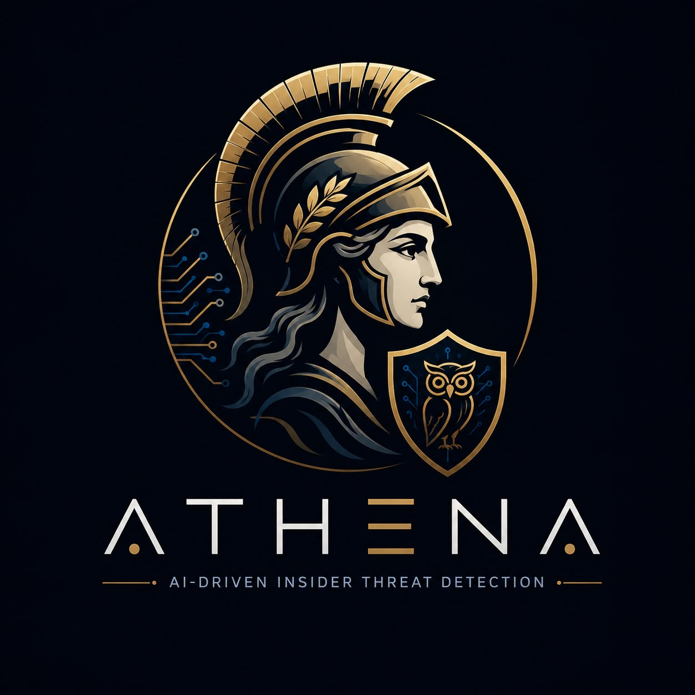

# 🦉 ATHENA ITD — AI-Driven Insider Threat Detection

<p align="center">
  
</p>

<p align="center">
  
  
  
  
  
</p>

ATHENA ITD is a cross-platform (**Linux · Windows · macOS**) platform that detects
**compromised accounts and malicious insiders** by learning each user's normal
behavior and flagging deviations in **real time**. It ships with a professional
**CLI** and a full **web SOC console**, backed by a trainable **ML ensemble** +
sixteen-detector rules engine that produces **explainable, prioritized risk
scores** — with case management, MITRE ATT&CK & compliance coverage, SIEM/SOAR
integrations and a complete triage workflow built in.

> Traditional monitoring misses the subtle behavioral changes that precede data
> theft, sabotage and privilege abuse. ATHENA continuously baselines user activity
> (logins, file access, data transfer, privilege use, geography, sequences),
> fuses four analytic signals into one 0–100 risk score per user, and surfaces
> the handful who warrant an analyst's attention — each with a clear explanation
> of *why*, the ATT&CK techniques observed, and a recommended response.

---

## ✨ What's inside

| Capability | Detail |
|---|---|
| **ML ensemble** | Isolation Forest + Local Outlier Factor + PCA reconstruction + Ledoit-Wolf Mahalanobis over a **36-feature** user-day behavior vector, **fit → persisted → reused** to score live data. Composition is configurable. |
| **16 detectors** | Exfiltration volume, USB, personal-cloud upload, email forwarding/egress, brute force, off-hours, privilege abuse, impossible travel (real km/h velocity), Tor/VPN origin, mass collection, mass deletion, defense evasion, lateral movement, dormant-account activation, sensitive-data spikes, peer & sequence analytics. |
| **Signal fusion** | ML + rules + peer-group deviation + action-sequence rarity, with configurable fusion weights, per-detector weight overrides and toggles. |
| **Explainability** | Every alert carries factor-by-factor explanations with evidence, per-feature σ-contributions, confidence, and MITRE ATT&CK technique IDs. |
| **Triage workflow** | Alert statuses (new → triaged → investigating → escalated → contained → resolved / false-positive) that **survive re-analysis**, assignees, analyst notes. |
| **Case management** | Investigation cases with severity, owner, verdicts (TP/FP/benign), HR/legal states, linked alerts and a notes trail. |
| **Watchlist** | Put departing/high-concern users under heightened scrutiny — risk multiplier applied at scoring time, with optional expiry. |
| **Analyst feedback loop** | TP/FP verdicts per alert feed per-detector precision stats — the tuning signal for detection engineering. |
| **MITRE ATT&CK** | Curated technique catalogue; live coverage matrix (tactic × technique) with alert-evidence heat in the console, CLI and reports. |
| **Compliance** | GDPR, HIPAA, ISO 27001:2022, SOC 2, PCI DSS v4, NIST 800-53 & CSF 2.0 control mappings with an auditor-facing coverage report. |
| **Geo & network intel** | Country-centroid travel-velocity math, high-risk jurisdictions, curated Tor/VPN/hosting/cloud IP reputation (+ operator intel feeds) — all offline/air-gap friendly. |
| **⚡ Real-time engine** | Background worker ingests live telemetry, re-scores the recent window continuously and pushes events + threat notifications over SSE. |
| **Automated response** | Eight response primitives (lock, revoke sessions, MFA, block downloads, isolate endpoint, revoke privileges, notify SOC/manager), playbook auto-response, simulated-by-default with a two-key enforcement gate. |
| **SIEM/SOAR fan-out** | Generic webhook, Slack, Teams, Splunk HEC, Elasticsearch, PagerDuty, syslog **CEF/LEEF**, SMTP — each activates when configured, gated by a minimum forward level. |
| **Access control** | Sign-in **on by default** with **role-based access control** (viewer · analyst · admin), self-service **sign-up** (always non-admin), **active-session management** (list & revoke live sign-ins), server-side sessions (only SHA-256 hashes stored), scrypt password hashing, CSRF double-submit protection, login throttling/lockout, per-caller **rate limiting**, configurable **CORS** allow-list, plus an API key for automation. |
| **Governance** | Operator audit log (who did what to the platform, attributed to the signed-in user), retention policy with purge, redacted config API. |
| **Real datasets** | First-class adapter for the **CMU CERT Insider Threat** benchmark + a deterministic synthetic enterprise generator with planted scenarios. |
| **Observability & ops** | Liveness (`/api/health`) + readiness (`/api/ready`) probes, `/api/version` build info, Prometheus `/api/metrics`, security headers, optional TLS, request logging, non-root Docker image with healthcheck, `athena doctor` deployment self-check, and `athena backup` / `athena restore`. |
| **Ships anywhere** | Python package, `python -m athena_itd`, Docker image, or standalone per-OS binaries (PyInstaller + CI). SQLite storage — zero external services. |

---

## 🏭 Production deployment

ATHENA runs from a laptop to a hardened server. For anything shared:

```bash
# Container behind auto-HTTPS (Caddy), state on a persistent volume
echo "ATHENA_API_KEY=$(openssl rand -hex 32)" > .env
docker compose up -d --build
curl -fsSL https://athena.example.com/api/health
```

- **[DEPLOYMENT.md](DEPLOYMENT.md)** — Docker/compose, systemd, TLS, env-var config,
  Prometheus scraping, backup/restore, upgrades.
- **[SECURITY.md](SECURITY.md)** — auth model, RBAC roles, hardening checklist, and
  an honest statement of current limits (local accounts today; SSO/OIDC on the roadmap).
- **[TUTORIAL.md](TUTORIAL.md)** — the complete hands-on tutorial: how the engine
  works inside, first run, console tour, real-log onboarding, triage, tuning,
  integrations, API automation and day-2 operations.
- **[ROADMAP.md](ROADMAP.md)** — what ships today, what's next (Sigma import,
  scheduled reports, IOC lists, honey users, SSO), and what stays out of scope.

Sign-in is **on by default**. On first start ATHENA seeds an admin from
`ATHENA_ADMIN_USER` / `ATHENA_ADMIN_PASSWORD`; if no password is provided, a **random
one-time password is generated and printed once in the server log** — there is no
shared built-in default. (Analysts can self-register at `/signup` as read-only
viewers.) Serve over TLS in any shared deployment (reverse proxy or
`athena serve --tls-cert … --tls-key …`). Disable open registration with
`ATHENA_ALLOW_SIGNUP=false`; an `ATHENA_API_KEY` grants machine access for SIEM/SOAR.

---

## 🚀 Quick start

```bash
pip install .
athena init

# Option A — instant demo with planted insider scenarios
athena generate --users 30 --days 30
athena analyze --respond

# Option B — train on a real dataset (CMU CERT) and score it
athena dataset load cert --path /path/to/cert/r4.2   # or: examples/cert_sample
athena train                                          # persists the ensemble
athena analyze

# Investigate & report
athena alerts
athena show <user>
athena mitre                # ATT&CK coverage + live hits
athena compliance           # control-framework coverage
athena report               # HTML + JSON, incl. governance sections

# Case & watchlist workflow
athena watchlist add mallory --reason "resignation notice" --days 30
athena cases open "Exfil investigation" --user mallory --severity HIGH
athena cases close 1 --confirmed --verdict true_positive

# Real-time: terminal live monitor …
athena monitor --eps 8 --inject-prob 0.05

# … or the full web SOC console (opens your browser)
athena serve --open
```

`make demo` runs the batch flow; `make serve` launches the console.

---

## 📊 The web SOC console

`athena serve --open` (or `athena gui`) serves a dark, modern SOC console at
<http://127.0.0.1:8000> organised into four sidebar sections:

| Section | Views |
|---|---|
| **Operations** | **Overview** (KPIs, threat level, trend & risk charts, top-risk users, platform status) · **⚡ Live Monitor** (start/stop engine, live event stream, threat notifications, toasts) · **Alerts** (full triage: status, assignee, TP/FP feedback, respond, open case) · **Response Log** |
| **Investigation** | **Users** (risk-ranked, searchable, watchlist stars; click-through investigation with hourly/daily charts, feature contributions, event tail, notes) · **Cases** (status/verdict workflow, linked alerts, case notes) · **Network Intel** (country activity with high-risk flags, source-IP reputation, live IP classifier) |
| **Governance** | **MITRE ATT&CK** (interactive coverage matrix with alert-evidence heat) · **Compliance** (seven frameworks, per-control status & evidence) · **Audit Trail** |
| **Platform** | **Data & Model** (generate, upload, datasets, train, analyze) · **Detection Config** (per-detector toggles + weight sliders, thresholds, fusion weights) · **Settings** (org, console auth, enforcement gate, retention + purge, all integrations) |

Every view is backed by the JSON API under `/api/*` (see `/docs`), so the same
backend can drive a SIEM integration or automation. Enable **Settings → require
API key** to lock the API behind an `X-API-Key` header.

---

## 🧠 How detection works

```
events ─► 36-feature user-day vectors ─► ┌────────────────────────────────┐
                                         │ ML ensemble (IF+LOF+PCA+Mahal.)│──┐
                                         └────────────────────────────────┘  │ fusion
                                         ┌────────────────────────────────┐  │ weights   0–100 risk
                                         │ 15 rule detectors vs baselines │──┼────────►  + band
                                         └────────────────────────────────┘  │           + explanations
                                         ┌────────────────────────────────┐  │           + ATT&CK IDs
                                         │ peer-group deviation (dept)    │──┤           + contributions
                                         └────────────────────────────────┘  │           + response plan
                                         ┌────────────────────────────────┐  │
                                         │ action-sequence rarity (bigram)│──┘
                                         └────────────────────────────────┘
```

* Rules compare each user against **their own learned baseline** (bytes moved in
  σ over their norm, first-ever USB use, dormancy gaps…), so a data-heavy role
  isn't perpetually flagged.
* **Peer analytics** flag the user who is normal for themselves but wildly
  abnormal for their department.
* **Sequence analytics** learn the organisation's action-transition model and
  flag improbable orderings (login → mass read → USB write).
* Watchlisted users get a scoring-time multiplier; per-detector weights and
  toggles are operator-tunable from the console.
* The analyzer evaluates a short **monitoring window** per user and reports
  their worst day, so a benign end-of-day spill-over can't mask a real anomaly.

**Validated:** on the synthetic benchmark the engine catches **100 % of planted
insider scenarios** with **zero HIGH+ false positives** across seeds, and the
CERT sample's planted insider surfaces as HIGH.

---

## ⚡ Real-time monitoring

The live engine (`athena_itd/stream.py`) simulates a continuous stream of
enterprise telemetry (the kind a SIEM/EDR forwards), persists it, and every few
seconds re-scores the recent window against the **trained model**, publishing
raw events and detected findings to subscribers:

```
collector ─► normalize ─► store ─┬─► live feed (SSE)        ─► dashboard / CLI
                                 └─► incremental scoring    ─► threat alerts + toasts
```

In production you replace the `_produce()` simulator with a real collector
(tailing logs / consuming a bus); everything downstream — scoring, alerting,
response, forwarding — is identical. Drive it from the **Live Monitor** view,
the `athena monitor` CLI, or the `/api/stream/*` endpoints.

---

## 🎓 Datasets & model training

- **CMU CERT Insider Threat Test Dataset** — the standard benchmark. Download a
  release (r4.2 / r5.2 / r6.2) from
  [kilthub.cmu.edu](https://kilthub.cmu.edu/articles/dataset/Insider_Threat_Test_Dataset/12841247)
  (DOI `10.1184/R1/12841247`), extract it, and:
  ```bash
  athena dataset inspect /path/to/cert/r4.2      # see which CSVs are present
  athena dataset load cert --path /path/to/cert/r4.2 --limit 200000
  athena train && athena analyze
  ```
  The adapter maps `logon/device/email/file/http` + `LDAP` into the ATHENA schema,
  with department/role enrichment and external-recipient egress flags. A tiny
  CERT-format sample is bundled at `examples/cert_sample/` (with a planted
  insider) so you can try the whole flow offline.

- **Synthetic enterprise** — `athena dataset load synthetic` (or `athena generate`)
  produces deterministic org telemetry with five planted insider scenarios;
  ideal for demos, tests and threshold calibration.

`athena train` fits the ensemble, learns per-user baselines, department peer
statistics and the action-transition model, and persists everything
(`model.joblib`). The live engine and `athena analyze` reuse it.

---

## ⌨️ CLI reference

| Command | Description |
|---|---|
| `athena init` | Initialize config + database. |
| `athena generate` | Synthetic activity with planted threats. |
| `athena dataset list / info / inspect / load` | Manage & load real datasets (CERT, synthetic). |
| `athena ingest <file>` | Ingest CSV / JSON / `auth.log`. |
| `athena train` | Train & persist the ensemble for live scoring. |
| `athena analyze [--respond]` | Score users (watchlist-aware), store explainable alerts. |
| `athena monitor` | Real-time terminal monitor (live feed + rolling alerts). |
| `athena alerts / show <user>` | Review findings. |
| `athena watchlist add/remove/list` | Heightened-scrutiny watchlist. |
| `athena cases list/open/close` | Investigation case management. |
| `athena mitre` | ATT&CK coverage matrix + live alert hits. |
| `athena compliance` | GDPR/HIPAA/ISO/SOC2/PCI/NIST coverage report. |
| `athena feedback-stats` | Per-detector precision from analyst verdicts. |
| `athena respond <user> --action …` | Dispatch a (simulated) response. |
| `athena report` | HTML + JSON reports with governance sections. |
| `athena intel <file.json>` | Load an operator threat-intel CIDR feed. |
| `athena purge` | Apply the data-retention policy. |
| `athena serve [--open] / athena gui` | Launch the web SOC console. |
| `athena reset` | Clear all local data. |

Run `athena --help` or `athena <cmd> --help` for options.

---

## 🔌 Configuration & integrations

State lives in an OS-appropriate directory (override with `ATHENA_HOME`):
Linux `~/.local/share/athena-itd`, macOS `~/Library/Application Support/athena-itd`,
Windows `%LOCALAPPDATA%\athena-itd`. `config.json` holds thresholds, fusion
weights, detector toggles/weights, sensitive-path classifications, personal
email/cloud domains, retention policy, console security and every integration.
Secrets can be injected via `ATHENA_*` environment variables instead of disk.

Configured sinks all receive alerts (≥ the configured forward level) and
response actions:

| Sink | Config keys |
|---|---|
| Generic SOAR webhook | `webhook_url` |
| Slack / Microsoft Teams | `slack_webhook`, `teams_webhook` |
| Splunk HEC | `splunk_hec_url`, `splunk_hec_token` |
| Elasticsearch | `elastic_url`, `elastic_api_key`, `elastic_index` |
| PagerDuty Events v2 | `pagerduty_routing_key` (HIGH+ only) |
| Syslog CEF / LEEF | `syslog_host`, `syslog_port`, `syslog_format` |
| SMTP email | `smtp_*` |

### Ingest schema
Fields are matched case-insensitively with common aliases:
`timestamp, user, action, host, source_ip, resource, bytes, success,
department, role, country` (only `timestamp` + `user` required). Vendor event
names (Windows event IDs, O365 operations, sshd messages…) are mapped onto the
canonical action vocabulary automatically, and replayed exports are de-duplicated
by fingerprint.

---

## 🛡️ Safety model

Response actions are **simulated by default** — recorded to the audit trail and
forwarded to your integrations, but they do **not** modify real accounts. Safe
for demos, evaluations and labs. Real enforcement requires **both** the
`--force` flag **and** `security.allow_enforced_response` in the config — a
deliberate two-key arrangement. Every operator action against the platform
itself (config changes, triage, responses, purges) lands in the audit log.

---

## 🧪 Development

```bash
python -m venv .venv && .venv/bin/pip install -e .[dev]
.venv/bin/python -m pytest        # 29 tests: pipeline + detectors + triage + governance
```

Standalone binaries: `packaging/build.sh` (Linux/macOS) or `packaging/build.ps1`
(Windows) — CI builds all three from `.github/workflows/build.yml`.

## 📄 License

**Proprietary — © 2026 Petro Plaku. All rights reserved.** Any use beyond local
evaluation requires the author's prior written permission — see
[LICENSE.md](LICENSE.md) for the terms and how to request a license
(**pplaku799@gmail.com**).
